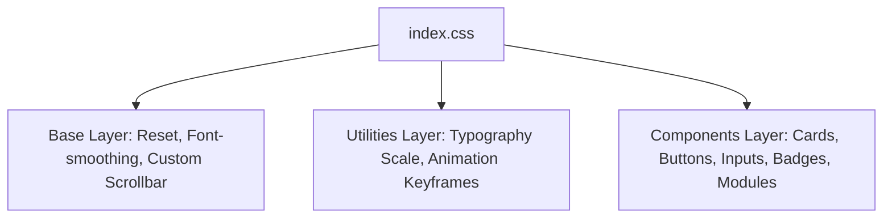

# EduSuite Pro — Enterprise School & College ERP
## System Architecture & Technical Documentation

---

### Table of Contents
1. [Executive Overview](#1-executive-overview)
2. [Technology Stack & Architectural Principles](#2-technology-stack--architectural-principles)
3. [Universal & Global CSS Design System](#3-universal--global-css-design-system)
4. [Typography Scale & Readability Enhancements](#4-typography-scale--readability-enhancements)
5. [Interactive Layout: Smooth Slide Out-In Sidebar](#5-interactive-layout-smooth-slide-out-in-sidebar)
6. [State Management Architecture](#6-state-management-architecture)
7. [Phase 1 Implemented Modules](#7-phase-1-implemented-modules)
8. [Project File Map & Directory Structure](#8-project-file-map--directory-structure)
9. [Developer Setup & Production Build](#9-developer-setup--production-build)

---

### 1. Executive Overview

EduSuite Pro is an enterprise-grade ERP system built for schools, multi-branch colleges, and educational institutes. The system was converted from a legacy static prototype (`code.html` and `Screen.png`) into a component-driven, responsive **React 18 Single Page Application (SPA)** powered by **Vite** and styled with an optimized **Universal Global CSS System**.

#### Key Objectives Met:
- **Modular Component Architecture**: Extracted repetitive HTML into reusable, composable React components.
- **Universal CSS**: Replaced bloated ad-hoc CSS with a unified design token system in [`src/index.css`](file:///c:/wamp64/www/erp/frontend/src/index.css), drastically reducing style redundancy and improving first contentful paint (FCP).
- **Responsive Layout with Slide Out-In Sidebar**: Added animated sidebar collapsing (`-translate-x-full` to `translate-x-0`) that expands the main viewport for high-density administrative data.
- **Enhanced Readability**: Increased typography scales across headings, KPIs, tables, and navigation links.
- **Phase 1 Module Coverage**: Built out all core foundational management pages (Dashboard, Institutes, Users & Roles, Students, Staff, Classes, Academic Year, and System Settings).

---

### 2. Technology Stack & Architectural Principles

| Layer | Technology | Purpose & Rationale |
| :--- | :--- | :--- |
| **Runtime / Core** | React 18 | Declarative component tree, fast virtual DOM reconciliation, strict mode support. |
| **Build Tool** | Vite 8+ | Lightning-fast Hot Module Replacement (HMR) and optimized esbuild/Rollup packaging. |
| **State Store** | Zustand | Zero-boilerplate lightweight global state management for UI and Auth states. |
| **Styling** | Tailwind CSS + Pure CSS Tokens | Semantic utilities combined with pre-computed CSS classes in `@layer components`. |
| **Iconography** | Google Material Symbols Outlined | Variable font symbols matching Google Material Design 3 guidelines. |
| **Typography** | Plus Jakarta Sans & Inter | Modern geometric sans-serif for headings and humanistic legible body copy. |

---

### 3. Universal & Global CSS Design System

Located in [`frontend/src/index.css`](file:///c:/wamp64/www/erp/frontend/src/index.css), the universal stylesheet is structured into three clean layers:



#### Key Design Tokens
- **Primary Color**: `#3525cd` (Deep Royal Indigo)
- **Background / Surface**: `#f8f9ff` (Soft Slate White)
- **Container Surfaces**: `#ffffff` (Elevated White), `#eff4ff` (Tinted Blue/Gray)
- **Text Color Hierarchy**: `#0b1c30` (On Surface - High Contrast), `#565e74` (Secondary/Muted), `#464555` (Tertiary)
- **Status Tints**:
  - Success / Active: `#6ffbbe` / `#002113`
  - Warning / Notice: `#fef3c7` / `#92400e`
  - Error / Critical: `#ffdad6` / `#93000a`
  - Info / Updated: `#e2dfff` / `#0f0069`

#### Standard Component Classes:
- `.card`: Clean elevated card with border and shadow.
- `.btn-primary`: Vibrant action button with subtle hover elevation (`translateY(-1px)`).
- `.btn-secondary`: Subtle tinted button for secondary actions.
- `.btn-ghost`: Low-emphasis utility button.
- `.module-tile`: Interactive square action tile with icon hover micro-zoom.
- `.badge-new`, `.badge-update`, `.badge-status`: Status pills for tags and table rows.
- `.input-field`: Standardized form control with primary focus ring.

---

### 4. Typography Scale & Readability Enhancements

Based on requirements, typography across the application has been increased for clarity and readability on desktop displays:

| Class | Font Size | Line Height | Weight | Font Family | Usage |
| :--- | :--- | :--- | :--- | :--- | :--- |
| `.text-headline-xl` | **40px** | 48px | 700 (Bold) | Plus Jakarta Sans | Main page banners |
| `.text-headline-lg` | **32px** | 40px | 600 (SemiBold) | Plus Jakarta Sans | Module & division headers |
| `.text-headline-md` | **24px** | 32px | 600 (SemiBold) | Plus Jakarta Sans | Card headers & modal titles |
| `.text-headline-sm` | **18px** | 26px | 600 (SemiBold) | Plus Jakarta Sans | Sub-section headers |
| `.stat-value` | **28px** | 1.1 | 700 (Bold) | Inter | Numerical KPI cards |
| `.text-body-lg` | **18px** | 28px | 400 (Regular) | Inter | Lead paragraph copy |
| `.text-body-md` | **15px** | 22px | 400 (Regular) | Inter | General content and descriptions |
| `.text-body-sm` | **13.5px** | 19px | 400 (Regular) | Inter | Metadata and table cell subtext |
| `.text-label-lg` | **15px** | 22px | 600 (SemiBold) | Inter | Button labels and form labels |
| `.text-label-md` | **13.5px** | 19px | 500 (Medium) | Inter | Navigation links |
| `.text-label-sm` | **12px** | 16px | 600 (SemiBold) | Inter | Small badges & indicators |

---

### 5. Interactive Layout: Smooth Slide Out-In Sidebar

To maximize screen real estate when examining large tables or academic plans, an animated **slide out / slide in sidebar** was implemented with zero layout jump.

#### Mechanism:
1. **Sidebar Component** ([`Sidebar.jsx`](file:///c:/wamp64/www/erp/frontend/src/components/layout/Sidebar.jsx)):
   - Slides along the X-axis: `transform transition-transform duration-300 cubic-bezier(0.4, 0, 0.2, 1)`.
   - Open state: `translate-x-0`.
   - Closed (slid out) state: `-translate-x-full`.
   - Includes a slide-out button in the logo row (`menu_open` icon) that invokes `toggleSidebar()`.
2. **Top Header** ([`Header.jsx`](file:///c:/wamp64/www/erp/frontend/src/components/layout/Header.jsx)):
   - Dynamically shifts its left anchor: `left-72` when open $\rightarrow$ `left-0` when slid out.
   - Smooth `transition-[left] duration-300 ease-in-out`.
   - Contains a persistent hamburger menu icon (`menu` / `menu_open`) allowing one-click slide in or out.
3. **Admin Layout** ([`AdminLayout.jsx`](file:///c:/wamp64/www/erp/frontend/src/components/layout/AdminLayout.jsx)):
   - Body viewport padding smoothly adapts: `lg:pl-72` when open $\rightarrow$ `pl-0` when closed.
   - Smooth `transition-[padding-left] duration-300 ease-in-out`.
4. **Mobile Responsiveness**:
   - Includes a frosted backdrop (`bg-neutral-900/40 backdrop-blur-xs`) on screens `< 1024px` that closes the drawer upon tapping outside.

---

### 6. State Management Architecture

State is decoupled into lightweight Zustand stores in [`src/store/useStore.js`](file:///c:/wamp64/www/erp/frontend/src/store/useStore.js):

#### 1. `useUIStore`:
- `sidebarOpen: boolean` — Controls whether the sidebar is visible or slid out.
- `toggleSidebar()` — Toggles sidebar visibility.
- `activePath: string` — Currently active route/module path.
- `setActivePath(path: string)` — Navigates between ERP modules.

#### 2. `useAuthStore`:
- `user`, `token`, `isAuthenticated` — Manages current session data with local storage persistence (`auth-storage`).

---

### 7. Phase 1 Implemented Modules

| Module Name | Component File | Description & Features |
| :--- | :--- | :--- |
| **Overview & Analytics** | [`Dashboard.jsx`](file:///c:/wamp64/www/erp/frontend/src/pages/Dashboard.jsx) | Real-time KPI cards (Students, Faculty, Attendance, Fees), SVG attendance graphs, dual-division operational matrix (40 tiles), birthday widget. |
| **Institute Management** | [`InstitutePage.jsx`](file:///c:/wamp64/www/erp/frontend/src/pages/InstitutePage.jsx) | Multi-campus directory, board and affiliation codes, student/staff headcounts, Add/Edit Institute modal. |
| **Users & Roles (RBAC)** | [`UsersPage.jsx`](file:///c:/wamp64/www/erp/frontend/src/pages/UsersPage.jsx) | Staff directory, permission matrices, user status badges, role creation modal. |
| **Student Roster & Admission** | [`StudentsPage.jsx`](file:///c:/wamp64/www/erp/frontend/src/pages/StudentsPage.jsx) | Searchable student table, admission records, fee clearance flags, multi-step student admission modal. |
| **Staff & HR Directory** | [`StaffPage.jsx`](file:///c:/wamp64/www/erp/frontend/src/pages/StaffPage.jsx) | Employee directory, designation, departments, contact info, Add Staff dialog. |
| **Class & Subjects** | [`ClassSubjectPage.jsx`](file:///c:/wamp64/www/erp/frontend/src/pages/ClassSubjectPage.jsx) | Section allocation, subject teacher assignments, streams (Science/Commerce/Arts). |
| **Academic Year & Sessions** | [`AcademicYearPage.jsx`](file:///c:/wamp64/www/erp/frontend/src/pages/AcademicYearPage.jsx) | Active session timeline, term date boundaries, session switcher. |
| **System Settings** | [`SettingsPage.jsx`](file:///c:/wamp64/www/erp/frontend/src/pages/SettingsPage.jsx) | Global currency, timezone, module toggles, SMS and payment gateway API configuration. |
| **Roadmap Placeholders** | [`PlaceholderPage.jsx`](file:///c:/wamp64/www/erp/frontend/src/pages/PlaceholderPage.jsx) | Unified fallback view for future phases (Transport, Hostel, Canteen, Timetable, Exams). |

---

### 8. Project File Map & Directory Structure

```
c:\wamp64\www\erp\frontend\
├── src\
│   ├── assets\                  # Icons and static resources
│   ├── components\
│   │   ├── layout\
│   │   │   ├── AdminLayout.jsx  # Main application shell with dynamic padding
│   │   │   ├── Header.jsx       # Header bar with search, quick actions & sidebar toggle
│   │   │   └── Sidebar.jsx      # Navigation sidebar with slide out-in animation
│   │   └── ui\
│   │       ├── Breadcrumb.jsx   # Breadcrumb navigation with enlarged text
│   │       └── PageWrapper.jsx  # Standard page wrapper with breadcrumb & status pill
│   ├── pages\
│   │   ├── AcademicYearPage.jsx # Academic year & term management
│   │   ├── ClassSubjectPage.jsx # Class & subject management
│   │   ├── Dashboard.jsx        # Primary executive dashboard & module grid
│   │   ├── InstitutePage.jsx    # Campus & institute management
│   │   ├── PlaceholderPage.jsx  # Fallback for future modules
│   │   ├── SettingsPage.jsx     # System configuration & API keys
│   │   ├── StaffPage.jsx        # HR and staff directory
│   │   ├── StudentsPage.jsx     # Student records & admission modal
│   │   └── UsersPage.jsx        # User administration & role permissions
│   ├── store\
│   │   └── useStore.js          # Zustand stores (useUIStore, useAuthStore)
│   ├── App.css                  # Minimal overrides
│   ├── App.jsx                  # Main routing hub
│   ├── index.css                # Universal CSS design system & typography scale
│   └── main.jsx                 # React root bootstrap
├── index.html                   # HTML entry point with Plus Jakarta Sans & Inter fonts
├── package.json                 # Dependencies & project scripts
├── tailwind.config.js           # Tailwind theme & design tokens
└── vite.config.js               # Vite configuration
```

---

### 9. Developer Setup & Production Build

#### Prerequisites:
- Node.js version 18.x or later
- npm or yarn

#### 1. Install Dependencies:
```bash
cd c:\wamp64\www\erp\frontend
npm install
```

#### 2. Start Local Development Server:
```bash
npm run dev -- --port 5173
```
The server will start at `http://localhost:5173/` (or `http://localhost:5174/` if port 5173 is occupied).

#### 3. Build for Production:
```bash
npm run build
```
Generates an optimized bundle in `frontend/dist/`.

#### 4. Preview Production Build:
```bash
npm run preview
```
